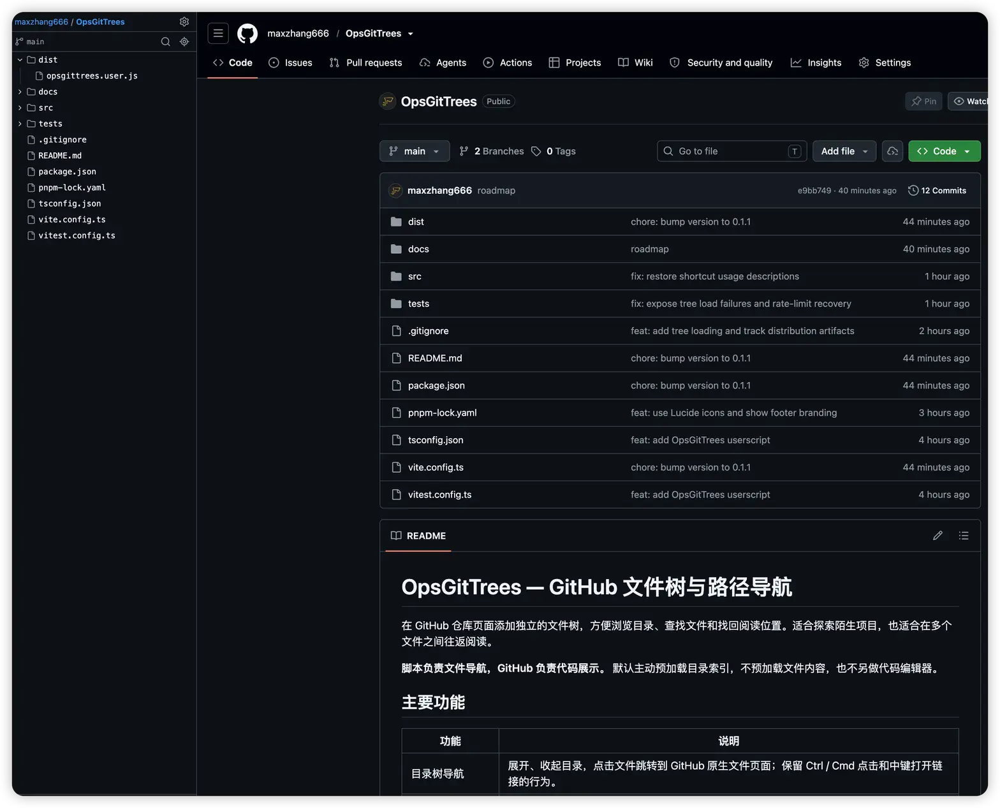
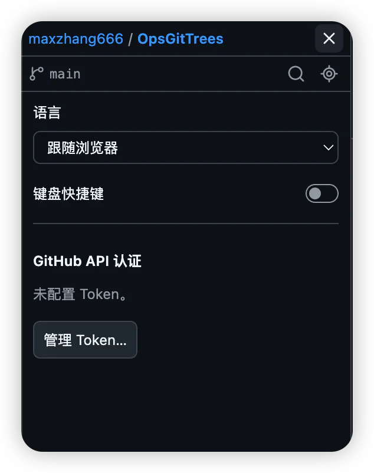
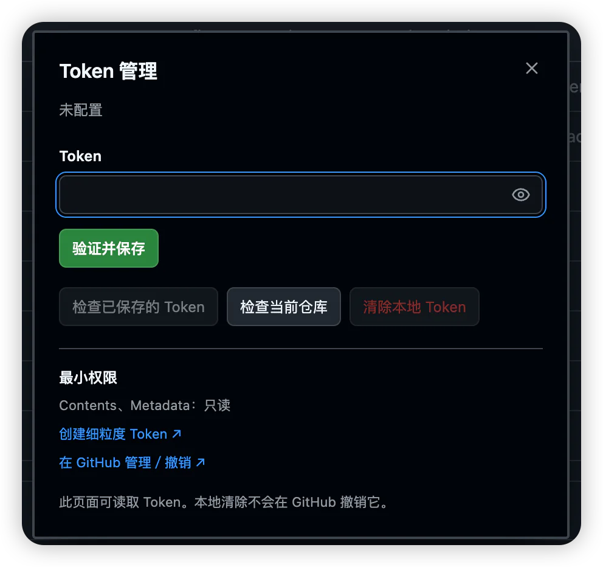

# OpsGitTrees — GitHub 文件树与路径导航

在 GitHub 仓库页面添加独立的文件树，方便浏览目录、查找文件和找回阅读位置。适合探索陌生项目，也适合在多个文件之间往返阅读。

**脚本负责文件导航，GitHub 负责代码展示。** 默认主动预加载目录索引，不预加载文件内容，也不另做代码编辑器。

## 项目链接

- **GitHub 仓库**：[github.com/maxzhang666/OpsGitTrees](https://github.com/maxzhang666/OpsGitTrees)
- **安装脚本**：[opsgittrees.user.js](https://raw.githubusercontent.com/maxzhang666/OpsGitTrees/main/dist/opsgittrees.user.js)
- **问题反馈**：[GitHub Issues](https://github.com/maxzhang666/OpsGitTrees/issues)

## 界面预览

侧栏设置与 Token 管理

**侧栏设置**

**Token 管理**

## 主要功能

| 功能 | 说明 |
| --- | --- |
| 目录树导航 | 展开、收起目录，点击文件跳转到 GitHub 原生文件页面；保留 Ctrl / Cmd 点击和中键打开链接的行为。 |
| 文件名与路径查找 | 在仓库目录索引中查找文件名或路径，忽略大小写，以过滤树展示结果，不限于已展开的目录。 |
| 当前文件定位 | 高亮当前文件，自动展开所在路径；点击“定位”可回到当前文件。 |
| 阅读状态记忆 | 记住目录展开状态和树的滚动位置，按仓库与分支分别保存。 |
| 可调整侧栏 | 支持收起、拖动调宽并记住设置；展开时为页面预留空间，不遮住代码，保留 GitHub 原生文件树。 |
| 页面与主题同步 | 跟随 GitHub 站内导航更新仓库、分支和文件状态，并跟随页面明暗主题。 |
| 中英文界面 | 支持简体中文和 English，默认跟随浏览器语言，可在设置中切换。 |
| 可选 Token 认证 | 公开仓库可匿名使用；配置 Token 后，可读取其授权范围内的仓库目录。 |

## 安装

1. 安装并启用 [ScriptCat（脚本猫）](https://scriptcat.org/) 浏览器扩展。
2. 点击 [安装脚本](https://raw.githubusercontent.com/maxzhang666/OpsGitTrees/main/dist/opsgittrees.user.js)，按脚本管理器提示安装。若浏览器只显示脚本文本，可复制完整内容，在脚本猫中新建脚本并保存。
3. 打开或刷新 GitHub 仓库首页、目录页或文件页，即可看到左侧文件导航。
4. 如脚本管理器提示连接授权，请允许访问 `api.github.com`，用于读取仓库目录及验证 Token。

公开仓库无需先配置 Token。适用站点为 `github.com`，暂不包含 GitHub Enterprise 自建实例及其他代码托管平台。

## 使用方法

- **浏览文件**：点击目录展开或收起，点击文件在 GitHub 中打开；Ctrl / Cmd 点击或中键可在新标签页打开文件。
- **查找路径**：在顶部输入框输入文件名或路径片段，例如 `package.json`、`src/`；清空输入可返回原来的目录浏览状态。
- **回到当前文件**：点击“定位”，清除查找并展开当前文件所在路径。
- **调整侧栏**：点击左上角按钮收起，点击左侧“文件”入口重新打开；拖动侧栏右边缘调整宽度。
- **切换语言**：进入“设置 → 语言”，选择“跟随浏览器 / 简体中文 / English”，无需刷新。语言等一般设置会在同一脚本管理器实例的标签页之间同步。

### 快捷键

| 快捷键 | 操作 |
| --- | --- |
| `Alt+Shift+O` | 打开或收起侧栏 |
| `Alt+Shift+F` | 打开侧栏并聚焦文件查找框 |

快捷键默认启用，可在侧栏“设置”中关闭；在输入框或可编辑区域内输入时不会触发。

## Token 配置（可选）

需要读取私有仓库，或希望使用认证后的 GitHub API 请求额度时，可配置细粒度个人访问令牌（fine-grained PAT）：

1. 前往 GitHub [创建细粒度 Token](https://github.com/settings/personal-access-tokens/new)。
2. 选择正确的资源所有者、需要访问的仓库和有效期，将 **Contents** 和 **Metadata** 权限设为 **Read-only**。组织仓库可能仍需审批或 SSO 授权。
3. 在侧栏打开“设置 → GitHub API 认证 → 管理 Token…”，粘贴 Token，点击“验证并保存”。也可从脚本管理器的“OpsGitTrees：管理 Token…”菜单打开。
4. 保存时验证 API 账户身份；再点击侧栏中的“检查当前仓库”，单独检查该仓库的读取权限。身份验证成功不代表能访问所有仓库，也不会审计额外授予的权限。

未保存 Token 时匿名请求；**验证并保存后，全部 GitHub API 请求都会使用该 Token，包括公开仓库**，无需另外开启开关。API 使用的账户可以与 GitHub 网页登录账户不同。

### 凭据与隐私

- Token 保存在本地浏览器的脚本管理器专用存储中。配置弹窗位于当前 GitHub 页面内，打开时自动回填已保存的 Token，默认密码遮罩；输入框右侧的眼睛按钮可切换显隐。
- **弹窗与 GitHub 页面共享 DOM，页面脚本可能读取输入或回填的 Token；密码遮罩和 Shadow DOM 不构成安全隔离。** 请仅授予所需仓库的只读权限，并设置合理的有效期。
- “清除本地 Token”会清除本地凭据并使私有缓存失效，**不会在 GitHub 撤销 Token**。如需撤销，请前往 [GitHub Token 管理页](https://github.com/settings/personal-access-tokens)；脚本管理器的备份和同步不受本脚本控制。

## 常见问题

### Token 保存在哪里？会发送到哪里？

**本项目没有服务器，也没有后端。Token 保存在本地浏览器的脚本管理器专用存储中。**

- **存储形式**：通过脚本管理器的 GM 存储 API 保存原始 Token 值，不写入 GitHub 页面的 `localStorage` 或 Cookie。
- **使用去向**：本脚本仅在验证身份和发起仓库 API 请求时，通过 HTTPS 的 `Authorization` 请求头将 Token 从浏览器直接发送给 GitHub 官方 API（`api.github.com`）。
- **备份与同步**：脚本管理器的备份／同步功能可能包含已保存的 Token，具体取决于管理器及你的配置，不受本脚本控制。如需只保留在本机，请检查并调整这些设置。

### 安装后没有出现侧栏？

确认脚本和脚本管理器已启用，并刷新 GitHub 仓库首页、目录页或文件页。若只是收起了侧栏，点击左侧“文件”入口，或使用脚本菜单“OpsGitTrees：打开文件导航”。非代码浏览页面不会显示文件树。

### 查找不到文件，是否说明文件不存在？

不一定。大仓库、网络失败或 GitHub API 限流可能导致索引尚未加载完整，请先查看侧栏状态。已加载的路径仍可浏览；出现“继续加载”按钮时，可按状态提示继续。**索引不完整时，查找结果也可能不完整。** 查找只匹配文件名和路径，不搜索代码正文。

### 网页能打开私有仓库，脚本却提示无权访问？

脚本通过 GitHub API 读取目录，不直接使用网页登录态代替 API 授权。请检查 Token 的资源所有者、仓库范围、有效期、只读权限以及组织审批或 SSO 状态，并用“检查当前仓库”确认访问权限。

### 提示执行环境不支持 Token 输入？

请重新安装本项目提供的完整脚本，保留其中的 content / DOM 隔离配置，再刷新 GitHub 页面；不要自行移除隔离声明。

## 当前版本与兼容性

当前版本为 **0.1.1**，仍处于早期阶段。已在真实 ScriptCat 环境验证部分交互；有效 Token 的完整保存／清除流程、真实私有仓库授权，以及其他浏览器和脚本管理器组合尚未完成完整实测，不作全面兼容承诺。

## 反馈与参与

遇到问题或有功能建议，欢迎到 [GitHub Issues](https://github.com/maxzhang666/OpsGitTrees/issues) 提交。反馈时请附上脚本版本、浏览器和脚本管理器版本、复现步骤，以及相关截图或错误提示。

欢迎通过 [Pull Request](https://github.com/maxzhang666/OpsGitTrees/pulls) 提交修复或改进。
